
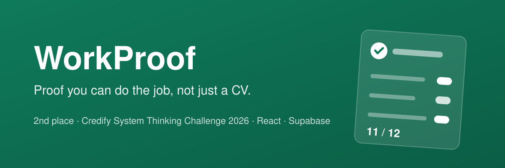

# WorkProof

**A hiring tool that lets employers judge graduates on the real work, not years of experience.**

🥈 **2nd place, Credify System Thinking Challenge 2026** (challenge area 04, graduate employability; 100+ applicants).

**▶ Live demo: [workproof-gray.vercel.app](https://workproof-gray.vercel.app)**. Nothing to install. Start with the sample ad, open the candidate link on a phone, and watch the answer arrive.

WorkProof turns a job ad an employer already has into a 45-minute test of the real work, sent to candidates' phones and scored blind. Instead of asking graduates for more evidence, it makes **being wrong about a graduate cheap**: a short work sample, a written scoring sheet, blind scoring and a receipt for every decision.

> The source code is private. This repo shows what the app does and how it's built. Code walkthroughs are available on request. **Pitch deck:** [PDF](docs/WorkProof-Pitch-Deck.pdf)

---

## How it works

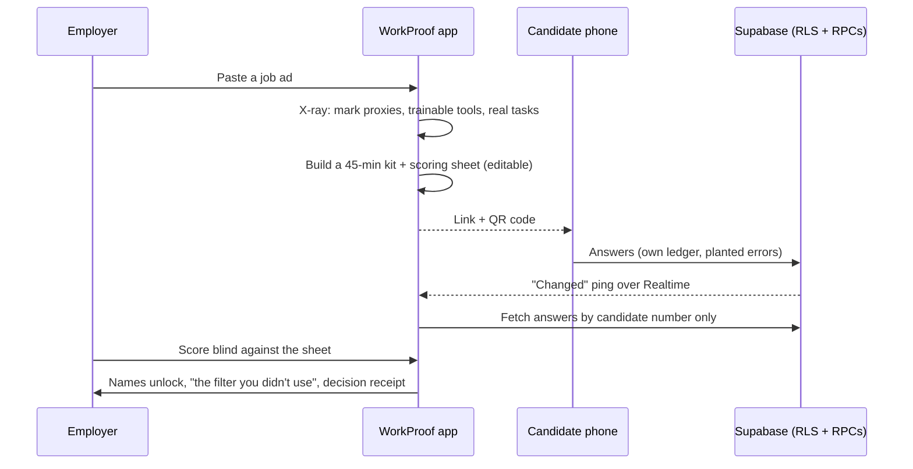

## What it does

1. **Ad X-ray.** Written rules mark each line of an ad as a *proxy* (years of experience, school marks, degree, own transport), *trainable* (a software tool) or a *real task*. It flags "Junior" ads whose requirements read senior, and hands back the ad rewritten without the proxies.
2. **Work-sample kit.** The real tasks become up to three abilities, a 45-minute test and a four-level scoring sheet. The employer can edit every word before sending.
3. **Candidate link.** A link and QR code. For the bookkeeping sample, each candidate gets their own ledger with 3 of 6 planted errors (20 combinations), so answers can't be passed around.
4. **Live inbox.** Answers arrive in about two seconds, shown by candidate number only.
5. **Blind scoring.** Each answer is scored against the written levels, with an answer key and a suggested follow-up question. Names unlock only after every answer is scored.
6. **The filter you didn't use.** Once names unlock, WorkProof shows what the ad's experience rule would have done to these real candidates: *"Your ad's '2+ years' rule would have rejected your top scorer."*
7. **Decision receipt.** Scores, answer key, declared AI use and the decision, plus feedback for the candidate and a ready-to-send result email.
8. **90-day check-in.** After hiring, the employer records how it's going, so over time they can see whether the test predicts the job.

## Engineering highlights

- **Rules where it must explain, AI where it drafts.** The X-ray is plain written rules, so every flag has a readable reason. Kit drafting uses an open-weight model on Groq with strict JSON-schema output, and falls back to a rules-built kit when there's no key or the rate limit is hit.
- **Database locked by default.** Row-level security on with **no policies**, so the browser can't read or write tables directly. Six `SECURITY DEFINER` functions are the only way in, checked by an invite code (candidates) or a per-invite employer key (employers).
- **Server-side validation.** Scores are checked on the server and merged per ability, so two quick saves can't overwrite each other.
- **Realtime without leaking data.** The Realtime channel only carries a "changed" ping. Answers are fetched through the locked functions, with an 8-second polling fallback if the websocket drops.
- **Privacy by design.** No ID number, age, CV or tracking cookies. Self-hosted fonts, so the app makes no third-party requests except to Supabase.
- **Tested:** 19 automated tests covering the X-ray rules and ad rewrite, planted errors and answer key, rules kit, experience-filter comparison and result email.

## Tech stack

| Layer | Tech |
|---|---|
| Frontend | React 19, TypeScript, Vite, Tailwind CSS 4 |
| Motion | Motion, GSAP, Lenis (all respect reduced-motion) |
| Backend | Supabase: Postgres, Row Level Security, `SECURITY DEFINER` RPCs, Realtime broadcast, Edge Functions (Deno) |
| AI drafting | Groq free tier, `openai/gpt-oss-120b`, strict JSON schema |
| Hosting | Vercel |

## Demo

<a href="media/workproof-demo.mp4">▶ Watch the full-quality video (MP4)</a>

All names, companies and emails in the demo are sample data.

### Employer

| Job ad | Ad X-ray | Work-sample kit |
|---|---|---|
| 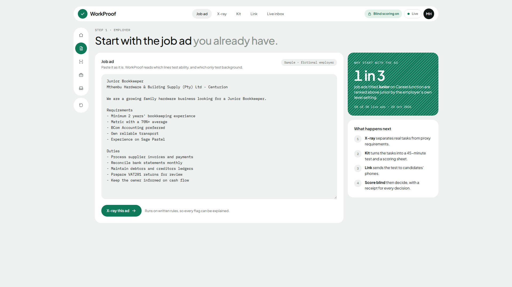 | 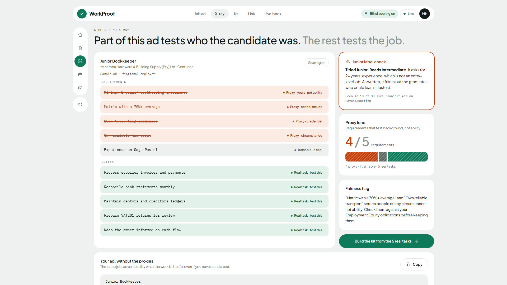 | 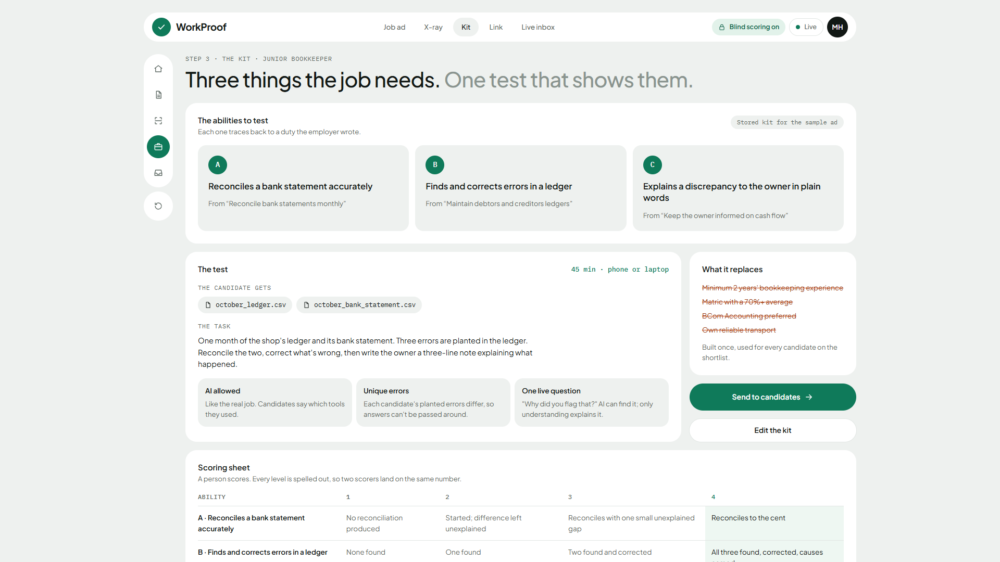 |

| Candidate link | Live inbox | Blind scoring |
|---|---|---|
| 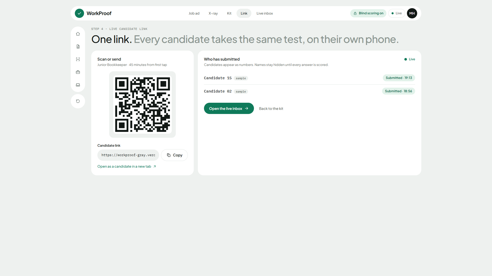 | 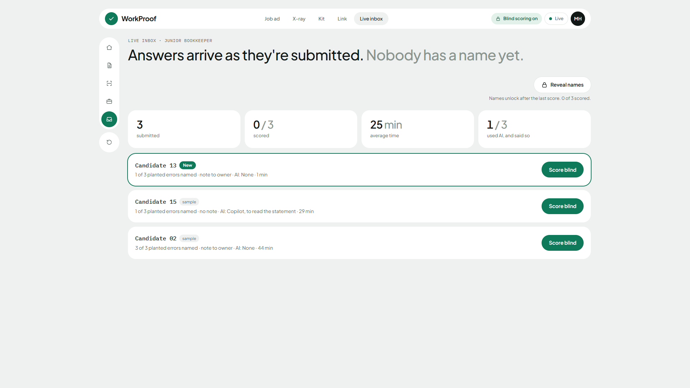 | 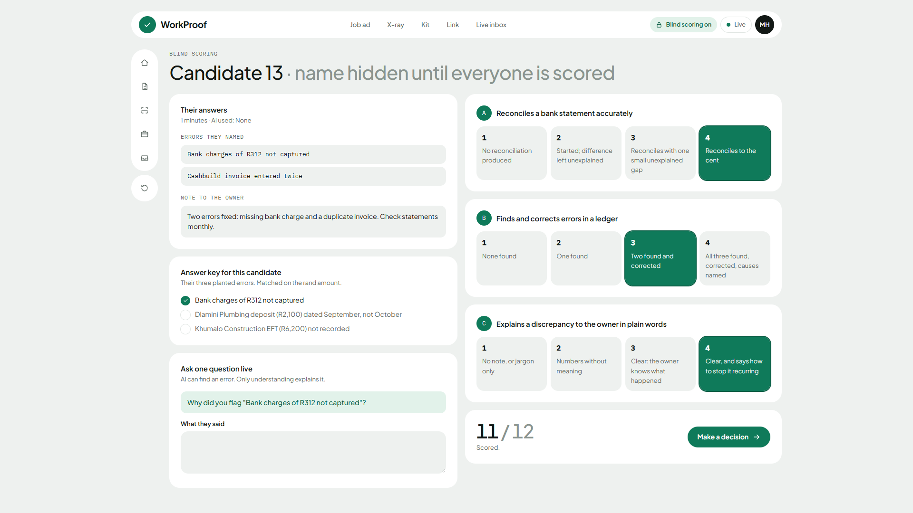 |

| The filter you didn't use | Decision receipt | Result email |
|---|---|---|
| 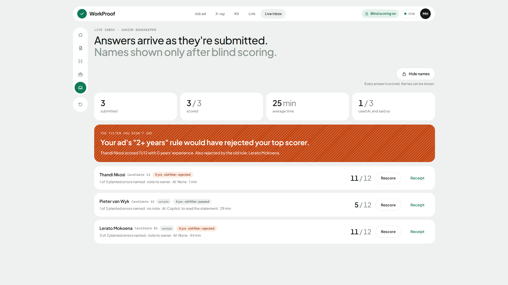 | 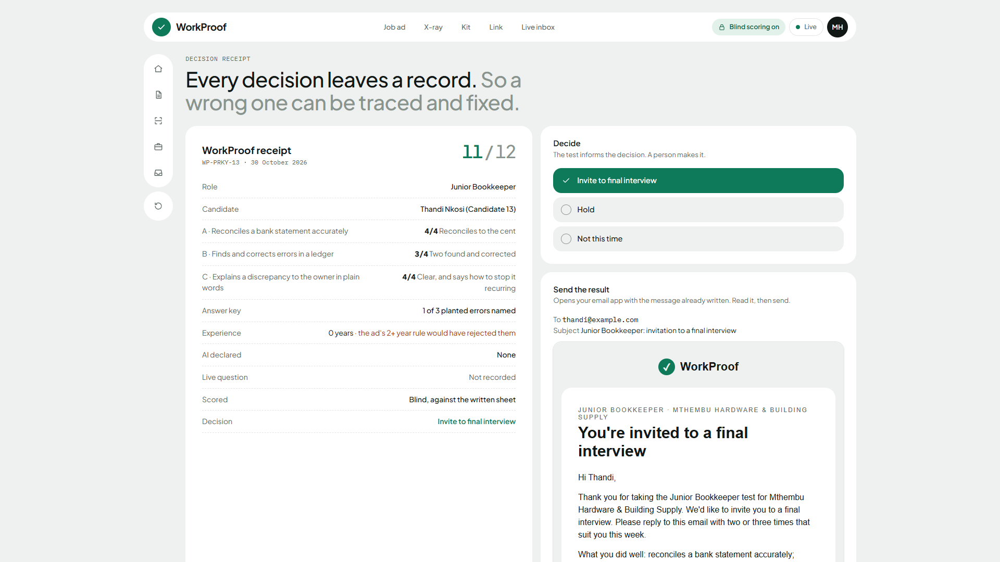 | 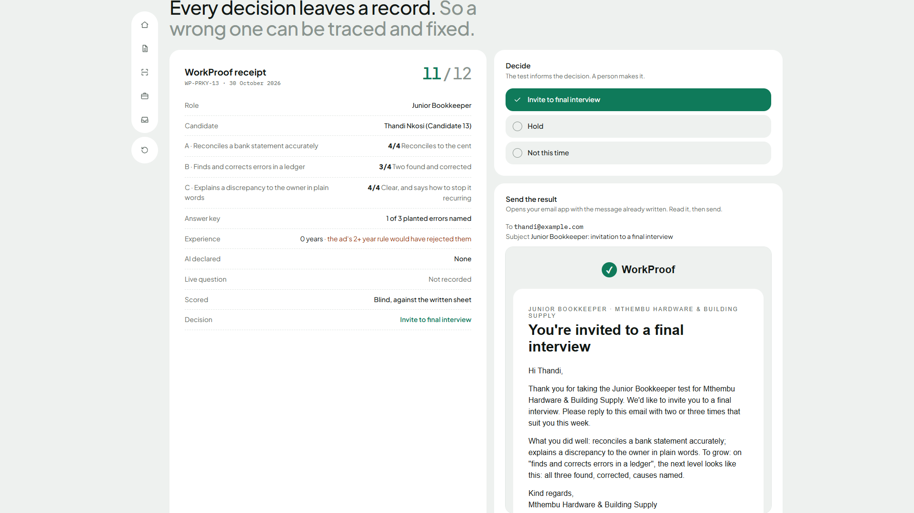 |

### Candidate (phone)

| Start | Answering | Done |
|---|---|---|
| 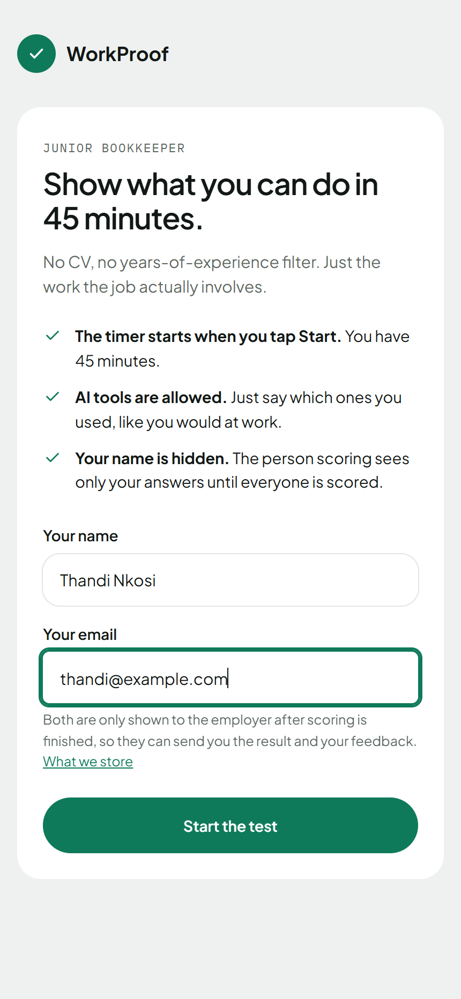 | 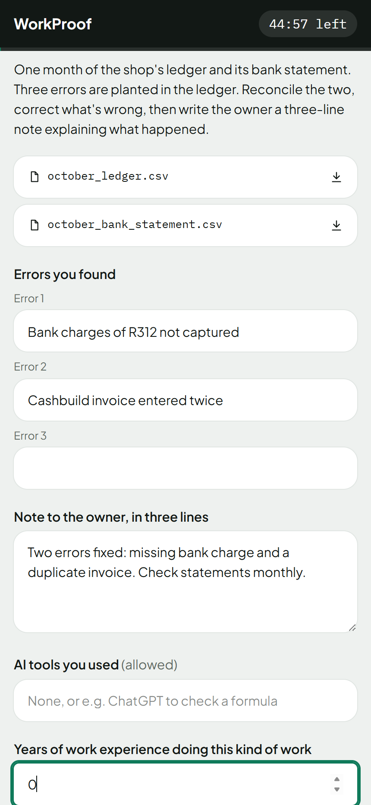 | 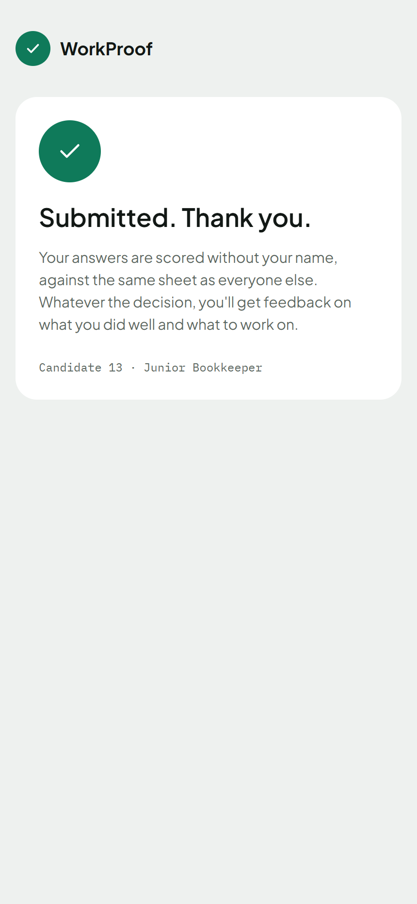 |

## What building this taught me

**1. Fix the system, not the person.** The obvious answer to "graduates lack experience" is to ask graduates for more evidence. Mapping the system showed the real constraint was on the employer's side: a bad junior hire is expensive and hard to undo. Making a wrong guess cheap changed more than any new evidence from candidates would.

**2. Rules where you need to explain, AI where you need to draft.** Written rules give every flag a reason an employer or judge can read. A model writes the test, and when it's missing or rate-limited the rules kit takes over, so the app never depends on it.

**3. Blind scoring has to be enforced by the system.** Telling scorers to ignore names isn't enough. Names, emails and years of experience stay hidden until every answer is scored.

**4. Cheating is a design problem.** Different planted errors per candidate make copied answers useless. Candidates may use AI, as they would at work, and a live follow-up question checks they understood.

**5. Lock the database and open narrow doors.** RLS with no policies, plus a few `SECURITY DEFINER` functions that each check a key, is easier to reason about than many policies.

**6. Anything public is a trust boundary.** The drafting function can be called by anyone, so it caps what it sends to the model and treats every input as untrusted.

**7. Realtime: send a ping, not the data.** The websocket only says "something changed", so no answers travel over it, and polling covers dropped connections.

**8. Distance is latency.** The nearest free Supabase region is Ireland, and the round trip from South Africa is why live updates take about two seconds. Server location is a product decision.

**9. `localhost` only means "this machine".** A phone scanning the QR code can't open `localhost`. Testing on real phones needs the computer's local network address or a public URL.

**10. Choose tools for the machine you have.** Vite instead of Next.js, because the laptop has 6.8 GB of RAM. Tools that keep you iterating beat "better" ones that stall the machine.

---

## Hire me

I build full-stack web and mobile apps with React, React Native and Supabase, from idea to production.

**GitHub:** [@yaseenselemane](https://github.com/yaseenselemane)
